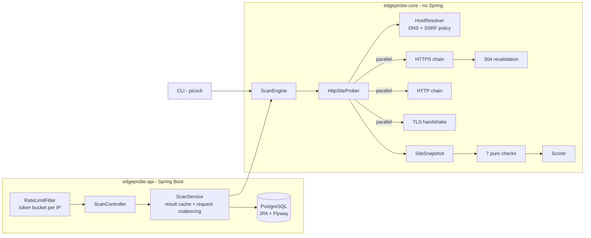

# edgeprobe

[](https://github.com/VardaanAggarwal/edgeprobe/actions/workflows/ci.yml)

**A web property diagnostics service.** Give it a URL and it checks the things that sit between a
site and its users: the TLS certificate, the HTTP-to-HTTPS redirect, security headers, caching and
revalidation, compression, HTTP/2 and time to first byte. It returns a graded JSON report with a fix
for every problem.

It ships as a **Spring Boot REST API** (scan history in PostgreSQL, result caching, request
coalescing, per-client rate limiting, Prometheus metrics, OpenAPI docs) and as a **CLI** that runs the
same engine locally and can fail a CI build when a site regresses.

```
$ java -jar edgeprobe.jar example.com
https://example.com/  Grade F (55/100)  1043 ms
  FAIL  HIGH    HTTP does not redirect to HTTPS
                 Return a 301 or 308 from every http:// URL to its https:// equivalent.
  FAIL  HIGH    HSTS header missing
                 Send 'Strict-Transport-Security: max-age=31536000; includeSubDomains' on HTTPS responses.
  WARN  MEDIUM  Content-Security-Policy missing
                 Start with a report-only policy, then enforce it.
  WARN  MEDIUM  No Cache-Control header
  ...
  12 passed, 5 warnings, 2 failures
```

Java 17 · Spring Boot 4 · Spring Data JPA · PostgreSQL · Flyway · Caffeine · Micrometer/Prometheus ·
springdoc OpenAPI · picocli · JUnit 5 · Testcontainers · Docker · GitHub Actions

---

## What it checks

| Check | What it looks at |
|---|---|
| `tls` | Chain trust and host-name match; expiry (fail under 7 days, warn under 21); negotiated protocol (TLS 1.0/1.1 fail); key size; SHA-1/MD5 signatures. On a validation failure it still reads the certificate to explain why ("expired", "self-signed", "does not cover this host"). |
| `https-redirect` | `http://` must redirect to `https://`, permanently (301/308), to the same host first (needed for HSTS preload), with no loops or long chains. |
| `security-headers` | HSTS and its max-age, Content-Security-Policy (including `'unsafe-inline'`), clickjacking protection, `nosniff`, Referrer-Policy, server version disclosure. |
| `caching` | Cache-Control, ETag/Last-Modified, and whether a conditional request really returns **304**; `Vary: *`; a **publicly cacheable response that sets a cookie** (a cache could hand one user's cookie to another); CDN cache status (`Cache-Status`, `X-Cache`, `Server-Timing: cdn-cache`, `Age`). |
| `compression` | Text responses use Brotli, gzip or zstd. |
| `performance` | Time to first byte (web.dev thresholds: 800 ms good, 1800 ms poor) and HTTP/2. |
| `dns` | Resolved addresses and IPv6 (AAAA) availability. |

Scoring: each FAIL subtracts its severity weight (critical 40, high 15, medium 8, low 3) and each WARN
half of it. Any critical failure (untrusted or expired certificate, no HTTPS) caps the grade at F.

## Architecture



Three Maven modules:

- **`edgeprobe-core`**: plain Java with no framework. Probing, checks and scoring.
- **`edgeprobe-api`**: the Spring Boot service.
- **`edgeprobe-cli`**: a picocli fat jar.

The API and the CLI share the same core, so a scan gives the same results from either.

## Design decisions

**Probe once, then run pure checks.** All network I/O happens in the prober, which builds one
immutable `SiteSnapshot`. Each check is a function from that snapshot to findings, with no I/O and no
shared state, so every rule is unit-tested with a hand-built snapshot (`Fixtures`). Adding a check
means one class and no network code.

**SSRF protection.** The API makes outbound requests to URLs that users submit, so without guards it
could be pointed at `169.254.169.254` (cloud metadata) or an internal service.

- **On input:** `TargetUrl` rejects non-http schemes, credentials in the URL and custom ports.
- **On every resolved address:** `HostResolver` resolves the host and checks *every* address it gets
  back against `AddressPolicy`. Checking only the first is not enough, because the client may
  connect to any of them. The policy blocks loopback, RFC 1918 private ranges, link-local, CGNAT,
  multicast, reserved ranges, IPv6 ULA and IPv4-embedded IPv6.
- **On every redirect hop:** redirects are followed manually, so each hop gets the same checks.
- **For the TLS probe:** it connects to the IP address that was already approved, rather than
  resolving the name a second time.

**Parallel probes, one deadline, partial results.** These run concurrently on a bounded thread pool:

- the HTTPS redirect chain
- the plain-HTTP chain
- the TLS handshake

When the HTTPS chain finishes, a conditional request tests revalidation. The whole scan has one
deadline. A probe still running at the deadline is reported as timed out, and the redirect hops it
already finished are kept. One slow piece never loses the rest of the report.

**Headers only.** Every check works from status codes and headers, so the prober closes each
response body as soon as headers arrive. Large or endless bodies are never downloaded.

**Request coalescing and result caching.** A burst of identical requests makes one set of outbound
connections, the same idea as request collapsing in a CDN.

- **Coalescing:** if a scan of a URL is already running, `ScanService` makes later callers wait on
  that scan's `CompletableFuture` instead of starting another.
- **Caching:** finished scans sit in a bounded Caffeine cache for 5 minutes. `fresh: true` skips the
  cache but still coalesces.

**Don't grade a block page.** An early live scan of a CDN-protected site got `403` from bot
protection on both `http://` and `https://`. edgeprobe then reported the block page's headers as the
site's failures. Now, if the final response is not a real 2xx page, the header checks report "could
not verify" and the scan is graded `?` instead of producing false failures. There is a regression
test for exactly that scan.

**Network work outside transactions.** A scan can take seconds. Only the final insert runs in a
transaction, so a slow site never holds a pooled database connection.

**Exact rate limiting.** The token bucket stores integer nanoseconds of credit, not fractional
tokens, so refill arithmetic is exact and `Retry-After` is precise. Buckets live in a size-bounded
Caffeine cache that evicts idle clients, so a flood of distinct IPs cannot exhaust memory.

**Errors as RFC 9457 problem details.** The API maps each error to a status:
- invalid URL: 400
- blocked target: 422
- unresolvable host: 422
- unknown scan: 404
- rate limited: 429, with `Retry-After`

All are returned as `application/problem+json`.

## Measured

On a MacBook (Apple Silicon), scanning from New Delhi, with the API in Docker:

| | Result |
|---|---|
| Fresh scan, 5 public sites | median **1.4 s** (0.1 to 2.3 s, mostly network round trips) |
| Repeat scan served from cache (300 warm requests) | **2.9 ms p50**, 7.3 ms p95, 10.8 ms p99 |
| 8 concurrent requests for the same URL | **1** probe; 7 requests coalesced onto it |
| Tests | 113 (unit, local HTTP/HTTPS server, and API integration tests on PostgreSQL via Testcontainers) |

## Run it

```bash
# API + PostgreSQL
docker compose up --build
open http://localhost:8080/swagger-ui.html

# Tests (Docker must be running for the PostgreSQL integration tests)
./mvnw verify

# CLI
./mvnw -pl edgeprobe-cli -am package -DskipTests
java -jar edgeprobe-cli/target/edgeprobe.jar github.com example.com --all
```

### API

```bash
# Scan (201 new, 200 + X-Edgeprobe-Cache: HIT or COALESCED when reused)
curl -s -X POST localhost:8080/api/v1/scans -H 'Content-Type: application/json' \
     -d '{"url":"github.com"}'

curl -s localhost:8080/api/v1/scans/{id}                        # one scan with findings
curl -s 'localhost:8080/api/v1/scans?host=github.com&size=20'   # history, newest first
curl -s localhost:8080/api/v1/checks                            # what every scan runs
curl -s localhost:8080/actuator/prometheus | grep edgeprobe     # metrics
```

### CLI in CI

Exit codes:
- `0`: within the threshold
- `1`: a finding reached the `--fail-on` level
- `2`: a URL could not be scanned

```yaml
- name: Check production edge config
  run: java -jar edgeprobe.jar www.example.com --fail-on warn
```

## Known limitations

- **DNS rebinding.** The TLS probe connects to the IP address that was already validated, but Java's
  `HttpClient` resolves the host name again for HTTP requests. A hostile DNS server could answer
  differently the second time. The fix is to connect HTTP requests to the pinned address too.
- **Per-instance state.** The cache, coalescing and rate limiter are in memory. Several instances
  would need a shared store such as Redis.
- **Synchronous scans.** `POST /scans` waits for the scan, which is bounded by a 15-second deadline.
  A job queue with polling or webhooks would suit long batch scans better.
- **TLS coverage.** Only the best protocol the server negotiates is checked. The JDK disables
  TLS 1.0/1.1 on the client side, so the scanner cannot detect a server that still *accepts* them.
  It also has no HTTP/3 support.
- **Point of view.** Time to first byte and CDN behaviour are measured from wherever edgeprobe runs.
  Sites with bot protection may block it entirely; those scans are graded `?`.
- **Timeouts.** Cancelling a timed-out probe does not interrupt a thread blocked inside
  `HttpClient.send`. It is bounded by the per-request timeout instead.
- **No authentication** on the API.

## Next steps

- Pin resolved IPs for HTTP requests, closing the DNS rebinding gap.
- Scheduled re-scans with alerts, such as a certificate expiring in 14 days or a grade dropping.
- Redis-backed cache and rate limiting for horizontal scaling.
- Java 21 virtual threads for the probe pool.
